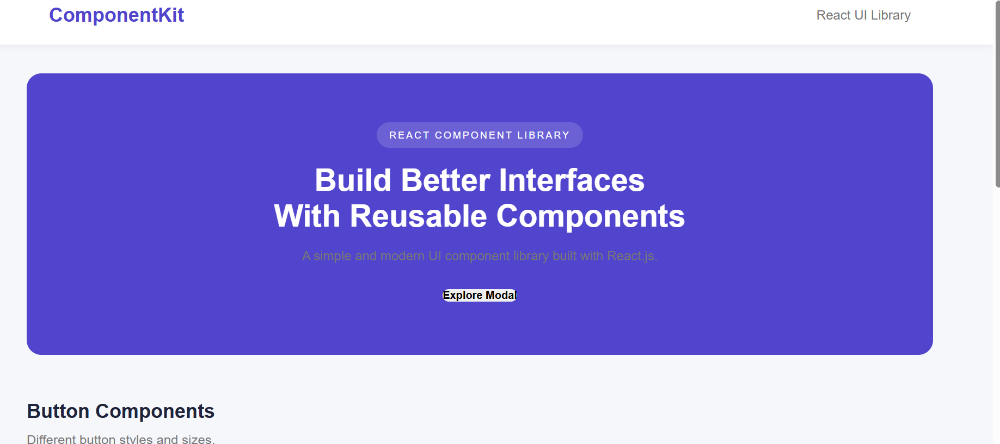
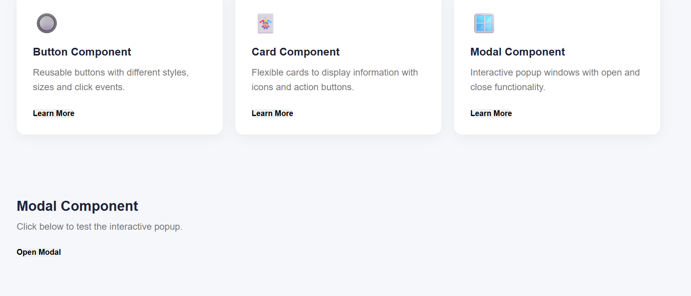
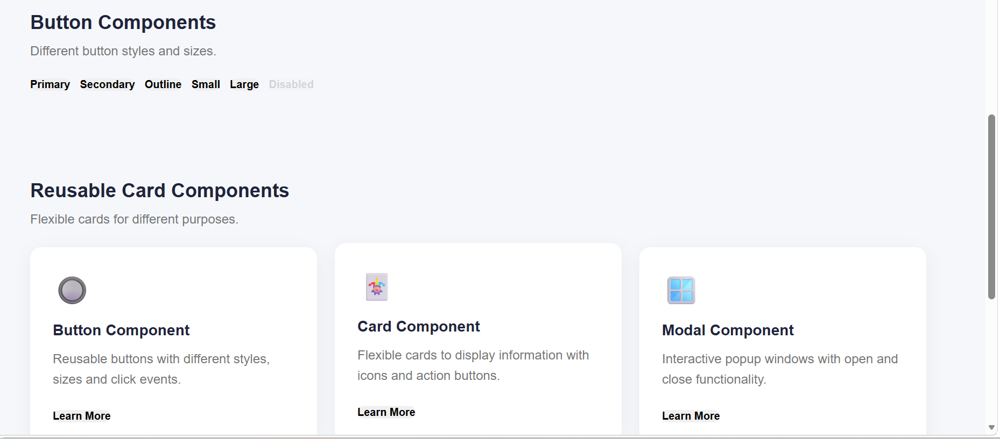

ComponentKit – React UI Component Library

ComponentKit is a simple and modern UI component library built using React.js. It demonstrates reusable UI components that help developers create clean and interactive user interfaces.

Features

- Button Component: Multiple styles, sizes, and disabled states.
- Card Component: Reusable cards with icons, descriptions, and action buttons.
- Modal Component: Interactive popup with open and close functionality.
- Responsive design for different screen sizes.

Technologies Used

- React.js
- JavaScript
- HTML5
- CSS3
- Vite

Installation and Setup

1. Clone the repository.

2. Open the project folder in VS Code.

3. Install dependencies:
   
   "npm install"

4. Start the development server:
   
   "npm run dev"

5. Open the local URL displayed in the terminal.

Project Structure

component-library-ui/
├── index.html
├── package.json
└── src/
    ├── components/
    │   ├── Button.jsx
    │   ├── Card.jsx
    │   └── Modal.jsx
    ├── App.jsx
    ├── App.css
    └── main.jsx

Author

Khairunnisa Athani# component-library-ui

## Project Output

### Home Page

### Modal and Button Components

